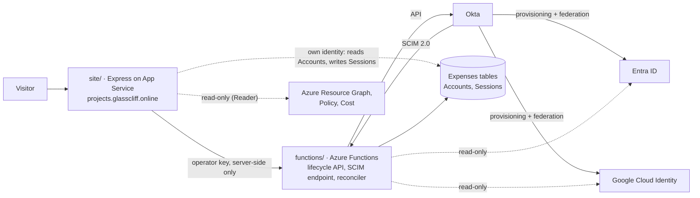

# Glasscliff labs

The code behind **[projects.glasscliff.online](https://projects.glasscliff.online)**: an Okta identity lab and a small Azure landing zone, built in personal tenants on free tiers.

| Lab | Live page | What it shows |
| --- | --- | --- |
| Identity lifecycle | [/labs/identity/dashboard](https://projects.glasscliff.online/labs/identity/dashboard/) | Joiner, mover and leaver runs from Okta into a downstream app over SCIM. You can make a throwaway person, sign in as them, and watch offboarding end your session. |
| Directory federation | [/labs/identity/federation](https://projects.glasscliff.online/labs/identity/federation) | The same Okta account provisioned and federated into Entra ID and Google Cloud Identity |
| Reconciliation | [/labs/identity/recon](https://projects.glasscliff.online/labs/identity/recon) | A twice-daily, read-only check that all three directories still agree, with run history |
| Azure landing zone | [/labs/landing-zone](https://projects.glasscliff.online/labs/landing-zone/) | Management groups, guardrail policies, central logging and a budget, read live from Azure |

The write-ups behind each lab are on the site: [identity lab](https://projects.glasscliff.online/labs/identity/about), [landing zone](https://projects.glasscliff.online/labs/landing-zone/about).

## How it fits together



- **Okta is the source of truth.** The lifecycle API changes people in Okta. Okta pushes the change to the Glasscliff Expenses app over SCIM, and to Entra ID and Google through its own provisioning.
- **Every lifecycle step is checked against the target.** Requests to Okta are one kind of evidence, and a read of the target system afterwards is another. The dashboard labels each step with the kind it is.
- **The visitor demo has an independent check.** For a run you start yourself, the site reads the Expenses tables directly with its own managed identity, without going through the lifecycle API, and shows before, expected and observed values. That identity can read Accounts but not change them. It can write Sessions, because the site is also the Expenses app and records each sign-in there.
- **Visitors sign in for real.** The demo hands the visitor a one-time password for the throwaway person, so the session that offboarding ends is one they are using.
- **Nothing identifying is published.** People are pseudonyms (HMAC of the login with a server-side key), every public response passes through an allowlist masker, and the operator key never reaches a browser. The one exception is the readback for a visitor's own demo person, which shows the title and department they picked.

## Repository layout

```
site/                       Express site served at projects.glasscliff.online
  server.js                 routes; home and lab index pages
  layout.js                 page shell shared by every section
  dashboard/                operations dashboard, visitor demo, replays, readback
  expenses/                 Glasscliff Expenses: Okta OIDC sign-in, sessions
  recon/                    reconciliation page (masks the reconciler's output)
  federation/               federation write-up
  landingzone/              landing zone live view and policy check
  public/labs/assets/       shared stylesheet
  tools/record-scenario.js  turns a real run into a dashboard replay
  test/                     six suites, no cloud access needed
functions/                  Azure Functions (Node 20)
  src/functions/            lifecycle API, SCIM endpoint, demo, reconciler, health
  src/lib/recon/            directory readers, comparison, run history; README lists every rule
  test/                     node --test suites (+ Azurite-backed storage tests)
glasscliff-landing-zone/    landing zone Bicep, policy definitions, helper scripts
main.bicep                  lab infrastructure (Functions, storage, Key Vault, app settings)
modules/                    Bicep modules for main.bicep
.github/workflows/deploy.yml  test everything; deploy the half that changed
```

## Run the tests

```bash
(cd site && npm ci && npm test)          # 6 suites
(cd functions && npm ci && npm test)     # reconciler, history, downstream checks
```

`npm run test:storage` in `functions/` also needs [Azurite](https://learn.microsoft.com/azure/storage/common/storage-use-azurite) on its default ports. CI starts it for you.

## Deploy

- **Site and Functions**: `.github/workflows/deploy.yml` tests on every push and pull request. On `main` it deploys whichever half changed, signing in to Azure with OIDC, so no Azure credential is stored in GitHub. One-time setup is at the bottom of that file.
- **Infrastructure**: `main.bicep` is compiled in CI but deployed by hand, because it writes Key Vault secrets and merges app settings. Copy `main.parameters.example.json` to `main.parameters.json` (git-ignored) and fill it in. The landing zone has its own steps in [`glasscliff-landing-zone/README.md`](glasscliff-landing-zone/README.md).

## What is real and what isn't

- **Okta, Entra ID, Google Cloud Identity and Azure** are real tenants: Okta Integrator Free, Entra ID Free, Cloud Identity Free and an Azure for Students subscription. Okta's groups and sign-on policies are managed in Terraform in a separate repo, [okta-as-code](https://github.com/Spiiike/okta-as-code).
- **Glasscliff Expenses** is a small app built for the lab, so provisioning has a real target.
- **Demo people** are invented, with logins on a domain that has no mailbox. Visitors sign in as them with a password shown once, and they are deleted from Okta within minutes.
- **Replays** are labelled on the dashboard as *Recorded run* (captured by `tools/record-scenario.js`) or *Illustrative* (hand-written timings).
